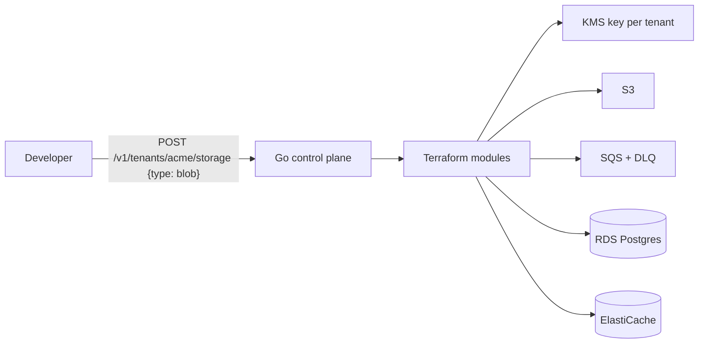

# bucketbroker: multi-tenant storage-as-a-service on AWS

A learning project. A developer asks for storage (`blob`, `queue`, …) for a tenant, and the platform
provisions it **encrypted, isolated, within quota, and tagged** on AWS, using Terraform modules
driven by a Go control plane.

Status: In-progress! KMS Module done, s3 bucket module in progress, sqs rds, and redis planned next.



Design details: [docs/design.md](docs/design.md). Decisions: [docs/adr/](docs/adr/).

## Roadmap

| Phase | What | Status |
|---|---|---|
| 1 | Terraform modules: KMS, S3, SQS, RDS, ElastiCache, all encrypted with KMS | 🚧 in progress |
| 2 | Per-tenant: own key, IAM boundary, quotas | ⏳ |
| 3 | Go control-plane REST API (`controlplane/`) | ⏳ |
| 4 | Second cloud (GCP) behind the same API | ⏳ stretch |
| ⭐ | Custom Terraform provider in Go | ⏳ bonus |

## Repo layout

```
terraform/modules/   reusable modules, one per storage type (+ kms_key)
terraform/envs/      root configs: local (LocalStack, free) and dev (real AWS)
controlplane/        Go API (Phase 3)
docs/                design doc, ADRs, on-prem→cloud mapping, learning log
```

## Setup (WSL2 Ubuntu)

Run these once. Read each command before you run it.

```bash
# Build tools: make (for the Makefile) and gcc (Go's race detector, `go test -race`, needs cgo)
sudo apt update && sudo apt install -y build-essential

# Terraform (HashiCorp apt repo)
wget -O- https://apt.releases.hashicorp.com/gpg | sudo gpg --dearmor -o /usr/share/keyrings/hashicorp-archive-keyring.gpg
echo "deb [signed-by=/usr/share/keyrings/hashicorp-archive-keyring.gpg] https://apt.releases.hashicorp.com $(lsb_release -cs) main" | sudo tee /etc/apt/sources.list.d/hashicorp.list
sudo apt update && sudo apt install -y terraform

# AWS CLI v2
curl -sSLo /tmp/awscliv2.zip https://awscli.amazonaws.com/awscli-exe-linux-x86_64.zip
unzip -q /tmp/awscliv2.zip -d /tmp && sudo /tmp/aws/install

# pre-commit (Python tooling)
sudo apt install -y pipx unzip && pipx ensurepath
pipx install pre-commit

# lstk: LocalStack's CLI. `lstk aws ...` runs AWS CLI commands against LocalStack.
# It replaces the deprecated `awslocal`. Other install options: https://docs.localstack.cloud/aws/developer-tools/running-localstack/lstk/
npm install -g @localstack/lstk

# tflint, trivy, terraform-docs: download release binaries from each project's GitHub releases page
#   https://github.com/terraform-linters/tflint/releases
#   https://trivy.dev/latest/getting-started/installation/   (has an apt repo)
#   https://github.com/terraform-docs/terraform-docs/releases
```

**Docker:** install Docker Desktop for Windows and turn on *Settings → Resources → WSL integration*
for your distro. Check with `docker run --rm hello-world`.

**LocalStack token:** create a free Hobby account at <https://app.localstack.cloud>, copy your auth
token, then run `cp .env.example .env` and paste it in.

**Git hooks:** `pre-commit install`

## Daily loop

```bash
make local-up        # start LocalStack
make check           # fmt, validate, lint, security scan. Same as CI.
make plan-local      # see what would change
make apply-local     # apply the saved plan
lstk aws s3 ls       # poke at what you built
make destroy-local
make local-down
```

> **`lstk aws` vs `aws`:** `lstk aws ...` talks to LocalStack. Plain `aws ...` uses your default
> profile and talks to your **real** AWS project. Check which one you typed before running anything that
> creates or deletes.

Real AWS (`terraform/envs/dev`): **apply the budget first** (see [budget.tf](terraform/envs/dev/budget.tf)),
keep `enable_rds` / `enable_redis` false unless you'll destroy in the same session, and always
end with `terraform destroy`.

## Conventions

- **Secure by default.** Modules don't offer an "unencrypted" option. Risky settings
  (`force_destroy`, `skip_final_snapshot`) default to the safe value and are overridden only in envs.
- **Module interface:** `name`, `tags` and `kms_key_arn` as inputs. Every variable has a `type`, a
  `description` and, where useful, a `validation {}` block. Outputs are IDs and ARNs, never secrets.
- **Tags:** `project`, `env`, `managed_by` via provider `default_tags`. `tenant` is added in Phase 2.
- **Versions:** modules use `>= x`; root configs use `~> x`; `.terraform.lock.hcl` is committed.
- **No secrets in git or state.** RDS uses `manage_master_user_password`. `*.tfvars` and `.env` are gitignored.
- **Supply chain:** GitHub Actions are pinned to commit SHAs, and Dependabot proposes bumps.
- **Git:** one branch per phase/module (`feat/kms-key-module`), [conventional commits](https://www.conventionalcommits.org/),
  and `make check` passes before you push.
- **Decisions:** when you weigh two or more real options, write an ADR.
