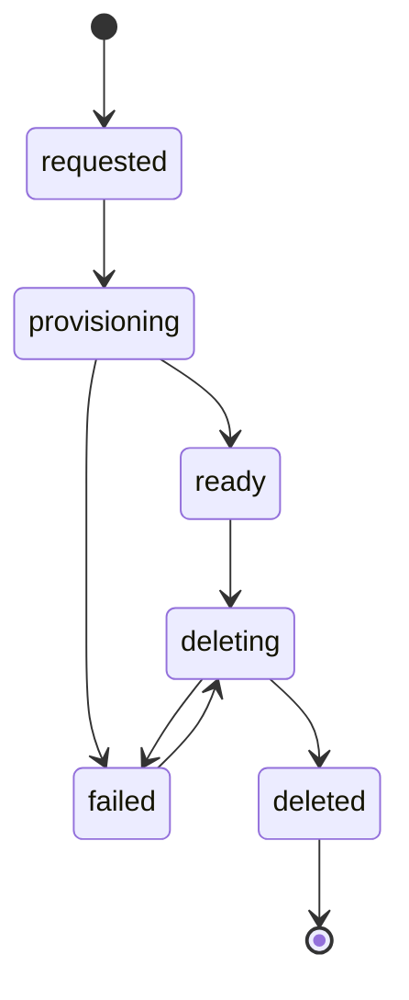

# Design: mini storage platform

> Status: **Draft**. Update this doc as each phase lands. A design doc that matches reality is
> worth more in an interview than a perfect one that doesn't.

## 1. Problem

Product teams need storage: object/blob, queues, relational DB, cache. Without a platform, each team
writes its own Terraform, picks its own encryption settings, and gets tenant isolation subtly wrong.
The platform team's job is to make the **safe path the easy path**:

> A developer asks for "a blob store for tenant `acme`". The platform provisions it encrypted, isolated,
> within quota, and tagged, and can tear it down cleanly later.

## 2. Requirements

### Functional
- Provision and deprovision storage by **type** (`blob`, `queue`, later `postgres`, `cache`) for a **tenant**.
- List a tenant's resources and their status.
- Enforce per-tenant **quotas** (e.g. max N queues, max X GB of blob).

### Non-functional
| Concern | Requirement | How (planned) |
|---|---|---|
| Isolation | Tenant A can never read or write tenant B's data | Per-tenant KMS key + IAM policy scoped to the tenant's resources (Phase 2) |
| Encryption | All data encrypted at rest and in transit | SSE-KMS with customer-managed keys; TLS-only bucket policies; `rds.force_ssl` |
| Safety | Deletes are deliberate and recoverable for a while | Versioning, deletion protection, KMS deletion window, soft-delete state |
| Idempotency | Retrying a request never creates duplicates | Idempotency keys on `POST`; Terraform is declarative (Phase 3) |
| Auditability | Know who provisioned what, and when | Tags (`tenant`, `owner`), CloudTrail, control-plane records |
| Cost | Close to $0 while learning | LocalStack-first; feature flags for paid services; budget alert |
| Portability | The same API works across clouds | `Provisioner` interface, with one implementation per cloud (Phase 4) |

## 3. Architecture

```mermaid
flowchart LR
    dev[Developer / service] -->|POST /v1/tenants/acme/storage\n{type: blob}| api

    subgraph cp[Control plane - Go, Phase 3]
        api[REST API] --> quota{Quota check}
        quota -->|ok| prov[Provisioner interface]
        api <--> db[(Control-plane DB\nresource records)]
    end

    prov -->|AWS impl| tf[Terraform modules\nterraform/modules/*]
    prov -.->|GCP impl, Phase 4| gcp[GCS / Pub/Sub]

    subgraph dp[Data plane - per tenant]
        tf --> kms[KMS key\nper tenant]
        tf --> s3[S3 bucket]
        tf --> sqs[SQS queue + DLQ]
        tf --> rds[(RDS Postgres)]
        tf --> redis[(ElastiCache)]
        kms -. encrypts .-> s3 & sqs & rds & redis
    end

    dev -->|reads/writes data directly\nwith tenant-scoped IAM| dp
```

### Control plane vs data plane

This split is central to storage-as-a-service, and you already know it from arrays: the
management GUI and API (control plane) vs the I/O path (data plane).

- **Control plane**: creates, configures and deletes resources. Low traffic, needs strong
  consistency, and it's fine for it to be slower.
- **Data plane**: the actual reads and writes to S3, SQS and Postgres. High traffic, and it must keep
  working **even if the control plane is down**. Developers talk to S3 directly. The control plane is
  never in the I/O path.

## 4. Resource model

```
Tenant (id, quota)
 └── StorageResource (id, tenant_id, type, name, status, cloud, cloud_ref, created_at)
```

### Lifecycle state machine



Why model it explicitly:
- Provisioning takes seconds for S3 and **5–10 minutes for RDS**. The API must return immediately
  (`202 Accepted`), and clients poll the status.
- Real failures (quota exceeded on the AWS side, a name collision, a throttling error) must be
  visible and retryable, not lost.

## 5. Key design decisions

Recorded as ADRs in [adr/](adr/):

1. [Record architecture decisions](adr/0001-record-architecture-decisions.md)
2. [LocalStack-first development](adr/0002-localstack-first-development.md)
3. [Terraform state backend](adr/0003-terraform-state-backend.md)
4. [Tenant isolation model](adr/0004-tenant-isolation-model.md) (Phase 2, open)

## 6. Open questions by phase

**Phase 1**
- Which settings should be configurable inputs, and which should be enforced and non-negotiable?
  (A platform says "no" to unencrypted buckets. It doesn't offer an `encrypted = false` input.)

**Phase 2**
- Bucket per tenant, or a shared bucket with prefixes? (See ADR 0004.) What about S3's per-account
  bucket limit at scale?
- How do you measure blob usage for a quota? S3 has no built-in size limit. Options: CloudWatch
  `BucketSizeBytes` (updated daily), S3 Storage Lens, or the control plane tracking writes itself.
- Is the quota a hard limit (reject) or a soft one (alert)? What happens to tenants already over quota?

**Phase 3**
- Does the provisioner call the AWS SDK directly, or run Terraform (`terraform-exec`)? What are the
  trade-offs in drift detection, speed and auditability?
- How do you make `POST` idempotent? An `Idempotency-Key` header stored with the record.
- What happens if the control plane crashes mid-provision? Use a reconciliation loop that compares
  desired state with actual state, the same idea as Kubernetes controllers.

**Phase 4**
- What does "blob" *guarantee* across clouds? Consistency, max object size, encryption semantics
  and IAM models all differ. The interface defines the lowest common denominator, or exposes
  capabilities.
